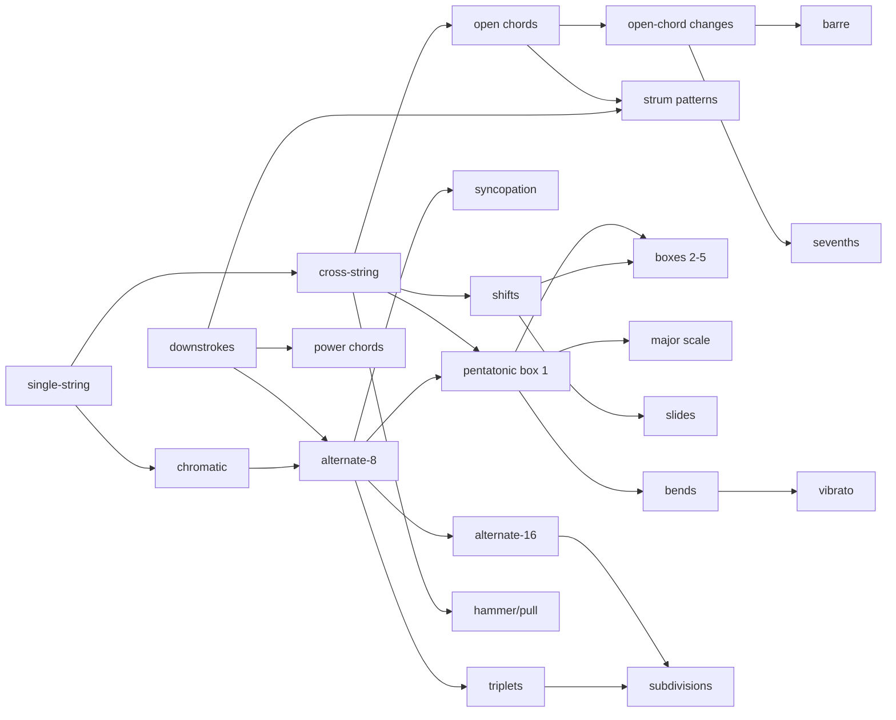

# Adaptive training plan ("Coach")

A design for turning Guitar Trainer from a play-along app into a daily, adaptive
practice system: open the app, do today's recommended session, get tested
periodically, and have the next sessions shaped by the results. Everything below is
specified against the code that already exists (chart model, scoring engine,
difficulty levels, synthesised audio) and keeps the app's constraints: free,
offline, all data on the device.

Status: **design, not yet implemented.** Phases and estimates are in §13.

---

## 1. What the player experiences

**Every day**

1. The home tab becomes **Today**: streak, minutes done this week, and a session of
   3–5 blocks sized to the player's time budget (default 20 min).
2. Each block is one tap away: a warm-up, a focused technique exercise, a song
   section at the right level, a short review of something learned earlier, and
   when due, a skill check.
3. Each block runs in the existing play engine (highway + scoring). Results go
   straight into the learner model; the next block may already be adjusted
   (tempo up after a clean run, down after a rough one).
4. Finishing one block keeps the streak. A "Quick 5" option exists for busy days.

**Periodically**

- **Placement test** on first use (6–10 short tasks, ~6 min) sets the starting point,
  or the player skips it and starts as a beginner.
- **Weekly checkpoint** (~5 min): one task on the current focus skill, one retention
  task on a skill learned earlier, one stretch task (next song level). Produces a
  short progress report.
- **Monthly assessment** (~10 min): re-runs the placement ladder around the player's
  current level to recalibrate and award milestones.

**Always explained.** Every recommendation carries its reason: *"Chord changes
Em→Am→D: 72% at 70 bpm on Tuesday. Today: same changes at 64 bpm, then the song at
Level 3."*

### Example week (20 min/day, goal "songs + rhythm")

| Day | Session | Why |
|---|---|---|
| Mon | Warm-up · Focus: open-chord changes 64 bpm · Song "Demo riff" L3 · Review: pentatonic box 1 | Chord changes rated 48 (learning), lowest among goal skills |
| Tue | Warm-up · Focus: strumming D-DU-UDU 80 bpm · Song L3 (loop bars 5–8) · Review: single-string melody | Interleave second skill; song had 61% on bars 5–8 |
| Wed | Warm-up · Focus: chord changes 68 bpm · **Checkpoint** (chord changes 70 · pentatonic 100 · song L4) | 6 days since last test, 3 sessions done |
| Thu | Comeback-light: review only, lower tempos | Warm-up accuracy 68% → off day |
| Fri | Warm-up · Focus: strumming 88 bpm · Song L4 · Review: chord changes | Checkpoint passed → L4 unlocked |
| Sat | Quick 5: chord changes 72 bpm | Player chose quick session |
| Sun | Rest (streak kept by one block or a freeze day) | |

---

## 2. Principles

1. **Train at the edge, not past it.** Target 80–90 % success. Training is fastest
   around an ~85 % success rate in the formal analysis by Wilson, Shenhav, Straccia
   and Cohen ([*The Eighty Five Percent Rule for optimal learning*, Nature
   Communications 2019](https://experts.arizona.edu/en/publications/the-eighty-five-percent-rule-for-optimal-learning/)); the result
   is derived for simple learners, so we treat it as a tuning target, not a law.
2. **Space and interleave.** Learned material comes back on a widening schedule;
   two focus skills alternate across days rather than one skill drilled for a week.
3. **Measure, don't guess.** Every adjustment comes from measured accuracy, timing
   precision and tempo. Results that the microphone cannot be trusted on are logged
   but down-weighted (§5).
4. **Music over drills.** Exercises are riffs, licks and real chord changes with a
   backing beat; every session applies the skill in a song.
5. **Short, consistent, kind.** Sessions default to 20 minutes, one block keeps
   the streak, and an off day lowers the bar instead of nagging.
6. **Explainable and local.** Rules, not black boxes; all data stays in IndexedDB
   with JSON export.

---

## 3. Skill model

Skills form a small prerequisite graph. Each skill has a measurable target
(accuracy at a tempo) and one or more exercise generators (§9).

| id | Skill | Category | Tier | Prereqs | Ref tempo → target | Measured by |
|---|---|---|---|---|---|---|
| `fret.single-string` | Single notes on one string | Fretting | 1 | – | 60 → 100 bpm quarters | melody accuracy |
| `fret.cross-string` | Notes across strings, open position | Fretting | 1 | single-string | 60 → 100 | melody accuracy |
| `fret.chromatic` | 1-2-3-4 finger independence ("spider") | Fretting | 1 | single-string | 60 → 120 eighths | accuracy + timing σ |
| `fret.shifts` | Position shifts | Fretting | 2 | cross-string | 70 → 110 | accuracy |
| `pick.downstrokes` | Downstrokes on the beat | Picking/rhythm | 1 | – | 60 → 120 quarters | timing σ, accuracy |
| `pick.alternate-8` | Alternate picking, eighths | Picking/rhythm | 2 | downstrokes, chromatic | 70 → 140 | accuracy + σ |
| `pick.alternate-16` | Alternate picking, sixteenths | Picking/rhythm | 3 | alternate-8 | 60 → 110 | accuracy + σ |
| `rhythm.syncopation` | Off-beat rhythms, ties | Picking/rhythm | 3 | alternate-8 | 70 → 110 | timing |
| `rhythm.triplets` | Triplet feel / shuffle | Picking/rhythm | 3 | alternate-8 | 70 → 120 | timing |
| `chord.open` | Open chords E A D G C Em Am Dm | Chords | 1 | cross-string | 50 → 80 (changes every 2 beats) | chord accuracy |
| `chord.changes-open` | Changes between open chords | Chords | 2 | chord.open | 50 → 100 | changes/min at ≥85 % |
| `chord.power` | Power chords, palm muting | Chords | 2 | downstrokes | 70 → 140 eighths | accuracy |
| `chord.barre` | Barre chords (F, Bm shapes) | Chords | 3 | changes-open | 50 → 90 | chord accuracy |
| `chord.strum-patterns` | Strumming patterns (D DU UDU …) | Chords | 2 | chord.open, downstrokes | 70 → 120 | timing + accuracy |
| `chord.sevenths` | Dominant/minor 7ths, add9 | Chords | 3 | changes-open | 60 → 100 | chord accuracy |
| `lead.pent-box1` | Minor pentatonic box 1 | Lead | 2 | cross-string, alternate-8 | 70 → 140 eighths | accuracy |
| `lead.pent-boxes` | Pentatonic boxes 2–5, connecting | Lead | 3 | pent-box1, shifts | 70 → 130 | accuracy |
| `lead.major-scale` | Major scale, one position | Lead | 3 | pent-box1 | 70 → 130 | accuracy |
| `lead.hammer-pull` | Hammer-ons and pull-offs | Lead | 2 | cross-string | 70 → 120 | accuracy |
| `lead.slides` | Slides into/out of notes | Lead | 2 | shifts | 70 → 120 | accuracy |
| `lead.bends` | Half/whole-step bends in tune | Lead | 3 | pent-box1 | 60 → 100 | bend pitch error ≤ 25 cents |
| `lead.vibrato` | Vibrato control | Lead | 4 | bends | – | pitch modulation depth/rate |
| `time.metronome` | Playing locked to a click | Timing | 1 | – | 60 → 140 | timing σ, drift |
| `time.subdivisions` | Switching 4ths/8ths/16ths/triplets on the fly | Timing | 3 | alternate-16, triplets | 70 → 110 | timing |
| `ear.tuning` | Tuning by ear, checked by the tuner | Ear | 1 | – | – | cents error after tuning |

Repertoire is modelled separately: every **song × level** is an item with its own
rating and review schedule (§4.3). Song items are what the "apply" block draws from.



A skill is **unlocked** when every prerequisite has an effective rating ≥ 60.

---

## 4. Learner model

### 4.1 State per skill

```ts
interface SkillState {
  skillId: string
  rating: number          // 0–100, Elo-style
  confidence: number      // recency-weighted attempt count
  tempoCeiling: number    // highest tempo with ≥85 % accuracy recently
  lastPracticedAt?: number
  lastTestedAt?: number
  ease: number            // review scheduling, starts 2.3
  intervalDays: number    // current review interval
  nextReviewAt?: number
  plateauStep?: number    // which intervention was applied last (§8)
  pinned?: boolean        // player chose to focus on this skill
}
```

Mastery bands: **new** < 20 · **learning** 20–50 · **developing** 50–75 ·
**solid** 75–90 · **mastered** ≥ 90.

### 4.2 Performance of one attempt

Every block (exercise rep, song section, test task) produces an attempt with the
scoring engine's numbers plus two additions the tracker needs to expose: the
distribution of hit timing errors and per-bar accuracy.

```
acc = (perfects + 0.8·goods) / total
tim = clamp(1 − σ_timing / 80 ms, 0, 1)        // σ of hit deltas after removing the median bias
                                                 // (fewer than 8 hits → tim = acc)
tmp = clamp(playedTempo / targetTempo, 0.5, 1.1) / 1.1
p   = 0.6·acc + 0.25·tim + 0.15·tmp              // performance, 0..1
```

Item difficulty (what the attempt was *against*):

```
d = tierBase(skill) + 30·log2(tempo / refTempo) + densityBonus + techniqueBonus
    tierBase: tier1 20 · tier2 40 · tier3 60 · tier4 80
    densityBonus: +0 quarters · +8 eighths · +16 sixteenths
    techniqueBonus: +5 per technique present (bend, slide, hammer/pull, palm mute)
```

Rating update (Elo-style, bounded 0–100):

```
expected = 1 / (1 + 10^((d − rating) / 25))
K = 6 for practice, 12 for tests, ×1.5 while confidence < 5
rating ← clamp(rating + K·(p − expected)·2, 0, 100)
confidence ← Σ over attempts of exp(−ageDays / 30)
```

Ten ordinary practice attempts can move a rating by roughly 30 points; a test moves
it twice as fast. Attempts flagged unreliable (§5) use K/3.

Tempo ceiling: highest tempo among the last 10 attempts (≤ 30 days old) with
acc ≥ 0.85; if none qualifies, 0.8 × the lowest tempo attempted.

Rust: a skill not practised for more than 14 days has an *effective* rating
`rating − 2·(days − 14)/7`, capped at −20. The stored rating is untouched; the
effective one drives planning and is shown as "rusty".

### 4.3 Song items

Key `${songId}:${level}` with `bestAccuracy`, `lastAt`, `ease`, `intervalDays`,
`nextReviewAt`, `weakBars: number[]` (bars under 70 % in the last run). A song level
counts as **learned** when accuracy ≥ 90 % at 100 % speed, which starts its review
schedule.

### 4.4 Review scheduling

SM-2-style, chosen for explainability; the MIT-licensed
[ts-fsrs](https://github.com/open-spaced-repetition/ts-fsrs) is the drop-in upgrade
if we later want FSRS's better retention modelling.

```
first interval after mastery: 2 days
after a review with performance p:
  p ≥ 0.85 → interval ← max(1, round(interval × ease)); ease ← min(2.8, ease + 0.05)
  0.70 ≤ p < 0.85 → interval ← max(1, round(interval × 1.2))
  p < 0.70 → interval ← 1; ease ← max(1.3, ease − 0.2)
nextReviewAt ← now + interval days
```

---

## 5. Evidence quality

Pitch detection through a phone mic is noisy, so every attempt carries a
reliability flag used to down-weight it:

- **Coverage**: fraction of expected-note windows during which the detector reported
  a clear pitch (clarity above threshold). Coverage < 0.6 → unreliable (mic too
  quiet, wrong device, speaker bleed).
- **Calibration age**: latency calibration older than 30 days → tests are blocked
  until re-calibrated; practice is allowed but flagged.
- **Timing bias**: |median hit delta| > 40 ms across a whole session suggests the
  latency setting is off → recommend calibration rather than penalising timing.
- **Chord leniency**: chord groups are currently scored on any matching tone, which
  inflates chord accuracy. Chord skills are marked *provisional* until chroma-based
  chord scoring (roadmap) lands; provisional ratings cap at 75.

---

## 6. Daily session planner

### 6.1 Inputs

Time budget (10/20/30/45 min), goals (any of: songs, rhythm & chords, lead,
technique, all-round), learner model, due reviews, test schedule, days since last
session, pinned skill.

### 6.2 Templates

| Budget | Blocks |
|---|---|
| 10 | focus 5 · song 4 · review 1 |
| 20 | warm-up 3 · focus 7 · song 7 · review 3 |
| 30 | warm-up 3 · focus 8 · second skill 6 · song 9 · review 4 |
| 45 | warm-up 4 · focus 10 · second skill 8 · song 15 · review 5 · ear/tuning 3 |

A due checkpoint (5 min) replaces the second skill or the review; a monthly
assessment (10 min) replaces focus + second skill that day.

### 6.3 Choosing the focus skill

For every unlocked, not-mastered skill:

```
priority = goalWeight × (1 − effectiveRating/100) × recency × readiness
  goalWeight: 1.5 if the skill's category is in the player's goals, 0.6 otherwise, 1.0 all-round
  recency:    1 + min(daysSincePracticed, 7) / 7
  readiness:  clamp(mean prerequisite rating / 100, 0.6, 1.0)
```

The top skill is today's focus unless it was the focus on both of the last two days
(then the runner-up takes over, which produces natural interleaving). A pinned skill
always wins. The second-skill block takes the next in priority from a different
category.

### 6.4 Tempo and content for a block

```
startTempo = tempoCeiling × 1.05 × dayFactor          (first time: skill.startTempo)
dayFactor from the warm-up: acc ≥ 0.9 → 1.0 · 0.75–0.9 → 0.95 · < 0.75 → 0.9
reps: 2–4 of 45–60 s
after each rep: acc ≥ 0.9 → tempo +5 % (max +15 % per session)
               0.75–0.9 → keep
               < 0.75 → tempo −8 %
               two reps < 0.6 → switch to the prerequisite variant or halve density
```

Song block: choose the level whose predicted accuracy is closest to 85 %: start at
the best level with ≥ 85 %, move to the next level when the last result there was
≥ 90 %; if the next level scored < 70 % last time, play it at 80–90 % speed instead
of dropping back. Half the block loops the weakest bars (per-bar accuracy), the
other half is a full run.

### 6.5 Planner contract

```ts
interface SessionPlan { date: string; dayFactor: number; blocks: Block[] }
type Block =
  | { kind: 'warmup'; exercise: ExerciseRef; minutes: number }
  | { kind: 'focus' | 'second' | 'review'; skillId: string; exercise: ExerciseRef; tempo: number; reps: number; minutes: number; reason: string }
  | { kind: 'song'; songId: number; level: number; speed: number; loopBars?: [number, number]; minutes: number; reason: string }
  | { kind: 'test'; test: 'checkpoint' | 'monthly' | 'placement'; minutes: number }

planSession(model: LearnerModel, library: SongSummary[], prefs: Prefs, now: Date): SessionPlan
adaptAfterBlock(plan: SessionPlan, blockIndex: number, attempt: Attempt): SessionPlan
```

Both are pure functions over plain data so they can be unit-tested like the rest of
the engine.

---

## 7. Skill checks

| Test | When | Content | Length |
|---|---|---|---|
| Placement | first launch (skippable) | ladder of 10 tasks, stop after two consecutive fails | 4–7 min |
| Checkpoint | ≥ 6 days since last and ≥ 3 sessions in between | focus skill at tempoCeiling · retention task on a random solid/mastered skill · stretch: a song section at the next level | ~5 min |
| Monthly | ≥ 28 days since last placement/monthly | placement ladder from one tier below the current level upward | ~10 min |

**Placement ladder** (each task 30–40 s, with count-in): single-string melody 70 bpm
→ open-position melody 70 → Em–Am–D changes 60 → power-chord riff eighths 90 →
pentatonic box 1 eighths 80 → alternate-picked sixteenths 70 → F–C barre changes 60
→ blues lick with bends and hammer-ons 80 → strumming D-DU-UDU 90 → pentatonic
eighths 120. Passed task → related skills start at `d + 10`; failed → `d − 10`;
untouched skills inherit `mean(prerequisites) − 15`.

**Pass criteria** for any task: acc ≥ 0.85 and |median timing| ≤ 30 ms and
σ ≤ 60 ms. Tests run at 100 % speed, with the count-in, no pause or seek, one
attempt per day per task, and require calibration within 30 days.

**Effect**: test attempts update ratings with K = 12, set `lastTestedAt`, and the
checkpoint produces a report: rating deltas since the last checkpoint, tempo
ceilings gained, songs levelled up, and the next two weeks' focus.

---

## 8. Recommendation rules

| Trigger | Rule | Message pattern |
|---|---|---|
| Song result ≥ 90 % at 100 % speed | unlock next level; schedule review of this level | "Level 4 unlocked." |
| Song result 70–90 % | keep level, loop weakest bars next time | "Bars 5–8 were 58 %. Tomorrow loops them at 85 % speed." |
| Song result < 70 % | next time: same level at 80 % speed, or level down if two failures | "Let's slow it down before dropping a level." |
| Exercise rep ≥ 90 % twice | tempo +5 % (ratchet), log tempo milestone | "Chromatic now clean at 104 bpm." |
| Two reps < 60 % | prerequisite variant or density halved | "Back to quarters at 72 bpm, then eighths." |
| Test passed at target | target tempo +10 %; mastered at ≥ 95 % | "Power chords: 90 → 99 bpm target." |
| Test failed twice | add prerequisite drill for 3 sessions; tempo −15 % | "We'll build this from the downstroke drill." |
| Session timing bias > 40 ms | recommend latency calibration | "Everything landed 45 ms late — recalibrate?" |
| Coverage < 0.6 in a session | mic/device advice, results flagged | "The mic barely heard you. Headphones or an interface help." |
| Plateau (§8.1) | intervention ladder | "Two weeks flat on barre chords: precision week at 48 bpm." |
| Return after ≥ 7 days | comeback session, no tests, lower tempos | "Welcome back. Easy day to shake the rust off." |
| 14 days without any song play | add a song block even for technique goals | "Time to play music with it." |

### 8.1 Plateau detection

For a skill with ≥ 8 attempts over ≥ 14 days and rating < 75: fit the slope of
rating against time; slope < 0.3 points/day means plateau. Interventions, applied
in order and recorded in `plateauStep` so they are not repeated: (1) precision
week: tempo −20 %, reps doubled; (2) switch exercise variant; (3) three sessions on
the prerequisite skill; (4) show the skill's technique tips and suggest filming
yourself. If the rating still does not move, mark the skill "parked" for two weeks
and move the focus elsewhere.

---

## 9. Exercise library and generation

Exercises are generated as charts with the existing engine, so they get the same
highway, scoring and difficulty tooling as songs. Backing audio comes from the
synthesiser already used for the demo song (plucked reference notes + click), or
from the metronome alone for pure rhythm work.

| Generator | Parameters | Skills |
|---|---|---|
| `chromatic` | start fret, strings, note value, tempo, bars | fret.chromatic, pick.alternate-8/16 |
| `melody` | scale, position, contour (steps/skips), note value | fret.single-string, fret.cross-string, fret.shifts |
| `scaleRun` | scale/box, direction, note value, tempo | lead.pent-box1, lead.pent-boxes, lead.major-scale |
| `chordChanges` | chord list, beats per chord, strum pattern | chord.open, chord.changes-open, chord.barre, chord.sevenths |
| `strumPattern` | pattern (D/U/–), chord, bars | chord.strum-patterns, time.metronome |
| `powerChordRiff` | roots, rhythm (8ths, palm-mute flags) | chord.power, pick.downstrokes |
| `stringSkipping` | pattern, position | fret.cross-string, pick.alternate-8 |
| `legatoLick` | pentatonic cell with h/p markers | lead.hammer-pull |
| `slideLick` | target notes with slide-in/out | lead.slides |
| `bendTargets` | bend intervals, string/fret | lead.bends (scored on reached pitch) |
| `subdivisionSwitch` | bars alternating 4ths/8ths/16ths/triplets | time.subdivisions, rhythm.triplets, rhythm.syncopation |

Each generator returns `{ chart, difficulty, backing }` deterministically from its
parameters, so a test task is reproducible and its difficulty `d` is known in
advance. Generators use the fretboard assignment and chord shapes already in
`music/`, and the chart's `beats` grid so the difficulty generator and per-bar
statistics work unchanged.

---

## 10. Data model (Dexie version 2)

```
skillStates  skillId (pk), rating, confidence, tempoCeiling, lastPracticedAt, lastTestedAt,
             ease, intervalDays, nextReviewAt, plateauStep, pinned
attempts     ++id, at, kind (warmup|practice|song|review|test), skillId?, songId?, level?,
             exerciseId?, params, tempo, targetTempo, speed, accuracy, perfects, goods, misses,
             timingMedianMs, timingStdevMs, coverage, durationSec, performance, reliable, sessionId
             indexes: at, skillId, songId, sessionId
sessions     ++id, date (YYYY-MM-DD, unique), plan, completedBlocks, minutes, dayFactor
tests        ++id, at, type, tasks, report
songItems    key `${songId}:${level}` (pk), bestAccuracy, lastAt, ease, intervalDays, nextReviewAt, weakBars
profile      id = 1: goals, dailyMinutes, startedAt, streak, longestStreak, lastSessionDate,
             placementDoneAt, pinnedSkillId
```

Skill definitions and generators live in code (versioned), never in the database.
A JSON export/import of all tables gives backup and device transfer.

---

## 11. UI

- **Today** (new home tab; Songs moves to second position): streak and weekly
  minutes, the session as a checklist with per-block "Start", "Why this?" toggles
  the explanation, "Quick 5" and "Rest day" actions. After each block a result
  sheet shows accuracy, timing, tempo change and the next block.
- **Progress** tab: skill map grouped by category with rating bars, bands and tempo
  ceilings; rating-over-time chart per skill; minutes per week; test history and
  checkpoint reports; milestones.
- **Test flow**: full-screen stepper with a task card (instructions, target tempo,
  what is measured), count-in, result, next. Controls for pause, seek and speed are
  hidden.
- **Onboarding**: goals, daily minutes, placement test or "start as beginner".
- **Settings** additions: daily minutes, goals, pinned skill, test cadence, data
  export/import.

Reminders: iOS installed web apps support Web Push (16.4+), but push needs a server
to send from, which conflicts with "no backend". Phase 3 options: an optional tiny
push relay (Cloudflare Worker) or no reminders beyond the home-screen badge.

---

## 12. Modules

```
src/training/
  skills.ts            SKILLS: SkillDef[] with prerequisites, tiers, tempos, tips, generators
  exercises/           one generator per table row in §9, each (params) => { chart, difficulty, backing }
  performance.ts       attemptPerformance(result, context) → { acc, tim, tmp, p, reliable, coverage }
  learner.ts           applyAttempt(state, attempt), effectiveRating(state, now), band(), tempoCeiling()
  review.ts            nextReview(ease, intervalDays, p)
  planner.ts           planSession(), adaptAfterBlock()
  assessment.ts        placementLadder(), checkpointTasks(model), applyTestResults()
  recommend.ts         recommendations(model, recentAttempts) → Recommendation[] (with reasons)
  plateau.ts           detectPlateau(attempts), nextIntervention(state)
src/features/today/    TodayPage, BlockRunner (wraps PlayPage in exercise/test mode)
src/features/progress/ ProgressPage, SkillMap, charts
src/features/test/     TestFlow
```

Changes needed in the existing engine first:

1. `ScoreTracker`: expose hit deltas (median, σ), per-bar accuracy, and detection
   coverage.
2. Play page modes: **exercise** (chart + synthesised backing or click only, reps
   with tempo changes between reps, no song file) and **test** (locked speed, no
   pause/seek, single attempt).
3. **Section loop** (A–B bars) with auto-slowdown, which the song block relies on.
4. Chroma-based chord scoring, so chord skills can leave the provisional state.

---

## 13. Phases and estimates

| Phase | Scope | Estimate |
|---|---|---|
| 0 · Engine prep | tracker statistics, coverage metric, exercise and test modes, section loop | 3–4 days |
| 1 · Coach MVP | 12 skills, 6 generators (chromatic, melody, scaleRun, chordChanges, strumPattern, powerChordRiff), learner model + review scheduling + planner with unit tests, attempts logging, Today page with a 3–4 block session, basic Progress page, placement test with 6 tasks, Dexie v2 | 1.5–2 weeks |
| 2 · Testing loop | weekly checkpoint and monthly assessment, checkpoint report, recommendation rules with explanations, plateau detection, song integration (weak-bar loops, level suggestions), comeback sessions, onboarding with goals | 1.5 weeks |
| 3 · Depth | remaining skills and generators (barre, 16ths, legato, slides, bends, subdivisions), chroma chord scoring, milestones, export/import, optional reminders | 2 weeks |
| Later | FSRS via ts-fsrs, difficulty calibration from opt-in anonymised data, ear-training module, adaptive warm-ups from fatigue signals | – |

Phase 1 alone already delivers "open the app, do today's session, see progress".

---

## 14. Risks and open questions

- **Measurement noise** is the main risk: a bad mic day looks like regression.
  Reliability gating (§5), tests only after calibration, and recency-weighted
  confidence limit the damage; the rust rule and slow K keep single sessions from
  swinging ratings.
- **Chord scoring leniency** makes chord skills optimistic until chroma scoring
  exists; they are capped meanwhile.
- **Teaching to the exercise**: a player can get good at our drills and not at
  music. Every session includes a song block, and checkpoints include a song
  stretch task.
- **Motivation**: streak kept by one block, quick sessions, no streak loss on a
  declared rest day. Avoid XP inflation; milestones tied to real tempo and mastery.
- **Open decisions for the owner**: default session length (20 min proposed); goal
  categories; whether ear training ships in Phase 1 or 3; reminders strategy; whether
  the first version ships without the placement test (start everyone at tier 1 and
  let ratings climb fast with the ×1.5 low-confidence factor).

---

## 15. References

- Wilson, Shenhav, Straccia & Cohen, *The Eighty Five Percent Rule for optimal
  learning*, Nature Communications 10:4646 (2019) —
  [publication record](https://experts.arizona.edu/en/publications/the-eighty-five-percent-rule-for-optimal-learning/),
  [open-access PDF](https://escholarship.org/content/qt0v22s4g4/qt0v22s4g4.pdf?t=sdxgqm).
- [ts-fsrs](https://github.com/open-spaced-repetition/ts-fsrs) (MIT), TypeScript
  implementation of the FSRS scheduler, candidate replacement for the SM-2-style
  review scheduling in §4.4.
